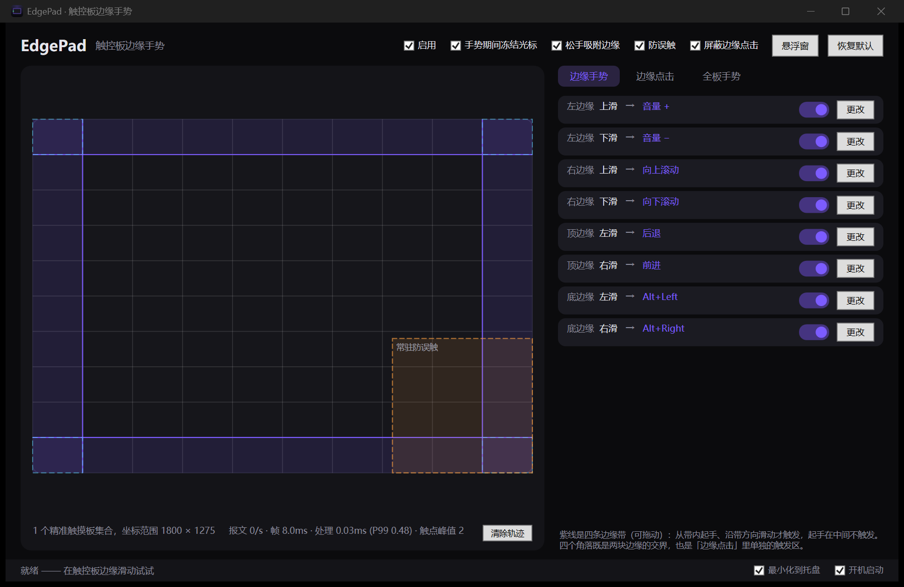
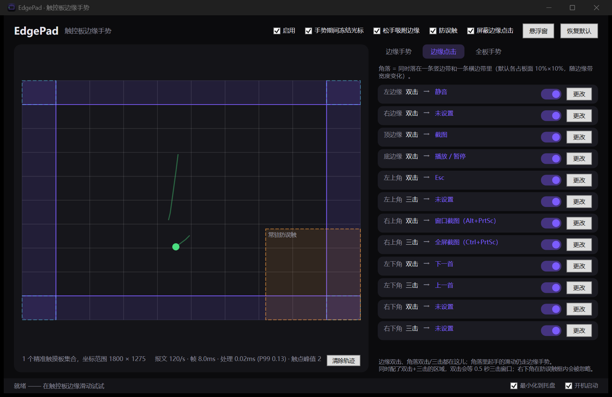
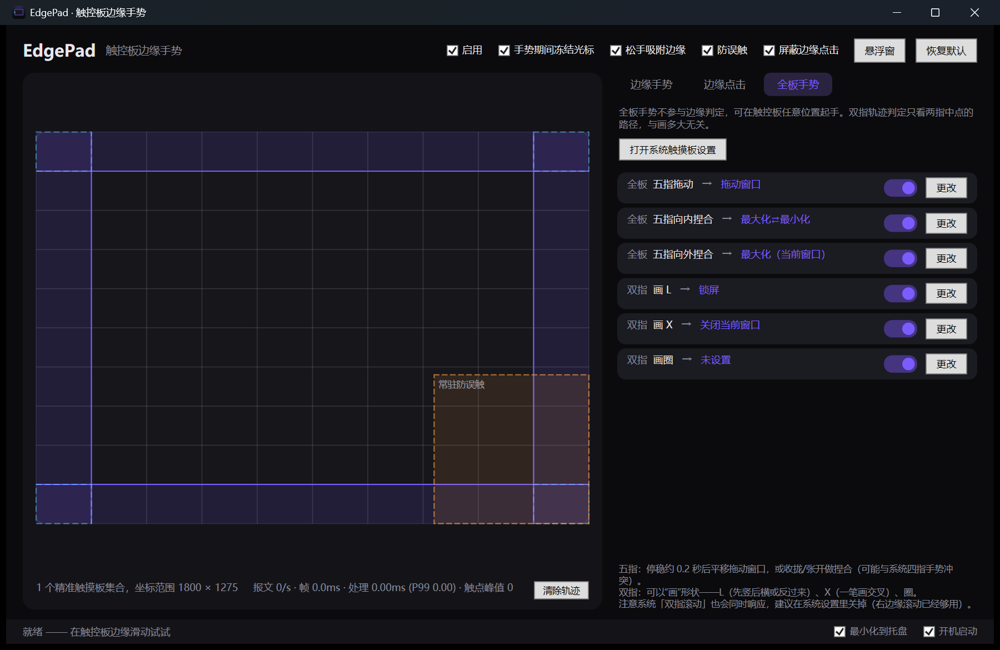
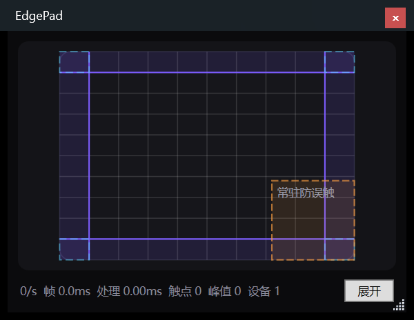

# EdgePad · Trackpad Edge Gestures

**简体中文** ｜ **English**

Give a Windows Precision Touchpad the edge gestures Windows never shipped: **edge swipes, corner double/triple taps, five-finger window drag, two-finger L/X drawing** — read straight off the trackpad, with no vendor driver and no system settings touched.

Built and verified on an Apple Magic Trackpad 2 (USB / PTP mode). Any trackpad that exposes a PTP collection (Usage Page `0x0D` / Usage `0x05`) should work.



> The app UI and the design notes (`docs/edge-pad.md`) are currently Chinese-only.

## What it solves

On Windows a Magic Trackpad can only use the stock three/four-finger gestures — edges and corners do nothing.
EdgePad turns the four edges and the four corners into independent trigger zones: start a swipe inside an edge and the action fires,
and **the cursor stays put** while the gesture runs, so the pointer never drifts away with your hand.

| Zone | Gesture | Default action |
|---|---|---|
| Left edge | swipe up / down | volume + / volume − |
| Right edge | swipe up / down | scroll up / scroll down |
| Top edge | swipe left / right | back / forward (Alt+← / Alt+→) |
| Bottom edge | swipe left / right | Alt+← / Alt+→ |
| Edges | double tap | mute, window screenshot |
| Corners | double / triple tap | Esc, window screenshot, full screenshot… |
| Whole pad | five-finger drag / pinch | drag the window (snaps on release) / switch window / maximize |
| Whole pad | two-finger L / X / circle | lock screen / close window / unbound |

Every action can be remapped to any key chord, a command line, or a built-in action (screenshot, media keys, window ops, scroll, lock screen),
and each action has its own on/off switch.

**Corners vs. edges**: a corner is both the intersection of two edges and its own tap zone — a **swipe** starting in a corner still uses the edge gesture,
a **double/triple tap** uses the corner action. The bottom-right corner sits inside the palm-rejection zone by default.

| Edge taps | Whole-pad gestures |
|---|---|
|  |  |

## Other details

- **Palm rejection**: a permanent palm zone in the bottom-right corner (resizable by dragging) plus a full pause while you type (detected from raw keyboard input)
- **Click suppression**: an edge double tap swallows the synthetic click Windows generates for "tap to click", so you don't accidentally click something
- **Receipts**: screenshots and media keys pop a small toast (media toasts include the track that is playing)

| Floating mini window | Toast |
|---|---|
|  |  |

- **Lives in the tray**: keeps working when minimized to the tray; optional run-at-login
- **Performance**: report handling P50 0.01 ms (P99 0.03 ms) · frame interval 8.0 ms / 125 Hz; a built-in UI-thread stall probe records who blocked it in the log

## Quick start

### Download

Grab `EdgePad.exe` from [Releases](https://github.com/lyfZhixing/edgepad/releases) — single file, no install, runtime included — and run it.
Windows may warn about an unknown publisher on first run: choose "More info → Run anyway".

### Build it yourself

Requires the .NET 10 SDK:

```bash
cd edgepad
dotnet build -c Release
./bin/Release/net10.0-windows10.0.19041.0/EdgePad.exe
```

Single-file bundle:

```bash
dotnet publish -c Release -r win-x64 --self-contained true \
  -p:PublishSingleFile=true -p:IncludeNativeLibrariesForSelfExtract=true -o publish
```

## Requirements and limits

- **Precision Touchpad only** (device manager shows "HID-compliant touch pad" and it exposes a PTP collection).
  A plain mouse, or an older Synaptics/Elan (PS/2) touchpad, will not work.
- System-level three/four-finger gestures and two-finger scrolling **cannot be intercepted from user mode**: drawing an L or an X with two fingers
  will scroll the page at the same time. Turning off two-finger scrolling (Settings → Bluetooth & devices → Touchpad) is recommended —
  right-edge scrolling already covers it.
- Five-finger pinch may collide with the system four-finger gestures; setting the system four-finger gestures to "None" is recommended.
- Cursor freezing is system-wide (`ClipCursor` pinned to 1×1) and only lasts as long as the gesture (usually well under a second).
- Thresholds, edge-band widths and the palm zone are all adjustable in the UI.

## Repository layout

| Path | What it is |
|---|---|
| `*.cs` / `*.xaml` | The app itself (WPF, target framework `net10.0-windows10.0.19041.0`) |
| `Engine.cs` | Gesture state machine: edge latching, direction, tap chains, five-finger, two-finger patterns |
| `TouchpadSource.cs` | Enumerates PTP collections, decodes HID reports into contacts |
| `PadView.cs` | Renders the pad map and handles edge-band dragging |
| `docs/edge-pad.md` | Full design record (Chinese): decisions, measured numbers, debugging history |
| `tools/*.ps1` | Dev helpers: screenshots, window lookup, clipboard, CPU/log watching |

## Self-checks

```bash
EdgePad.exe --selftest       # gesture state machine, 57 cases
EdgePad.exe --patterntest    # two-finger pattern recognition, 11 cases
EdgePad.exe --migratetest    # settings migration, 18 cases
EdgePad.exe --perftest       # per-frame cost of the hot path
EdgePad.exe --scrollbench    # scroll / injection / logging timings
```

## License

MIT
