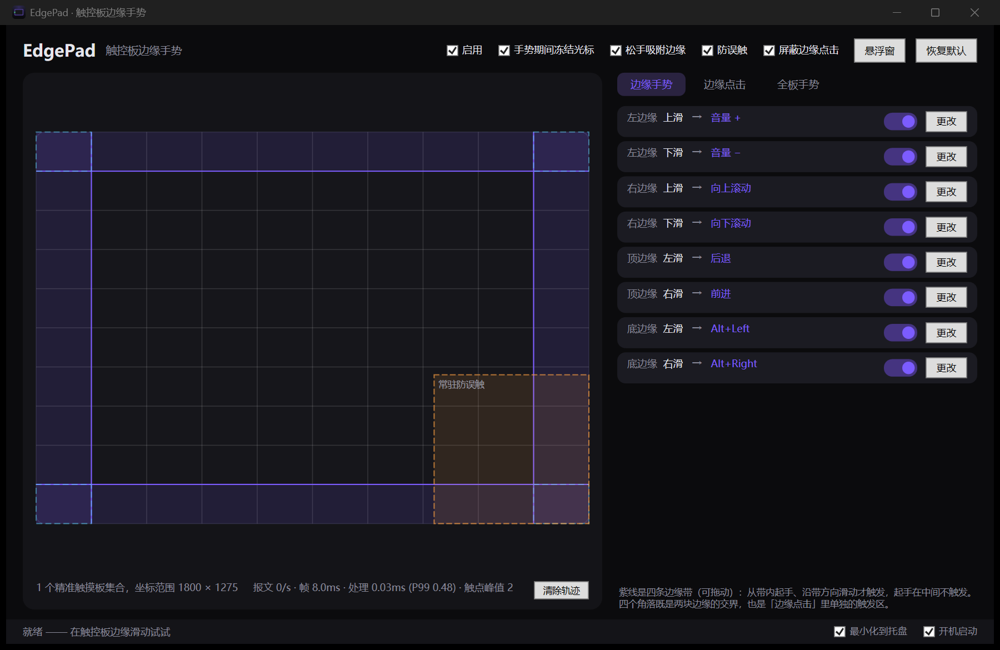
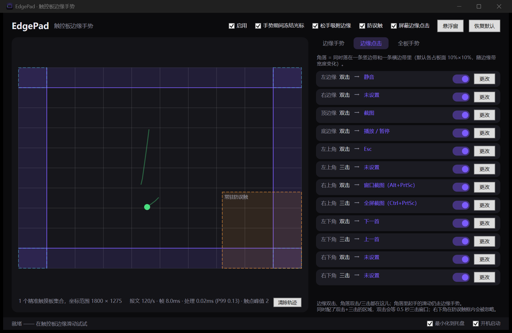
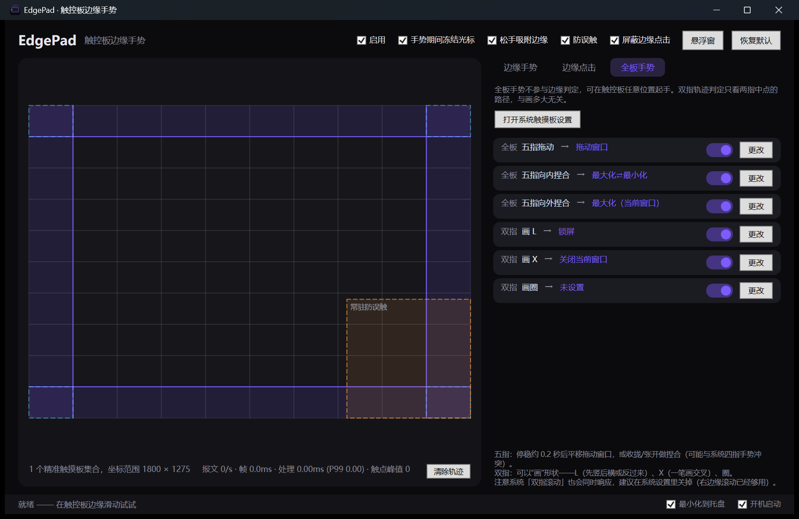
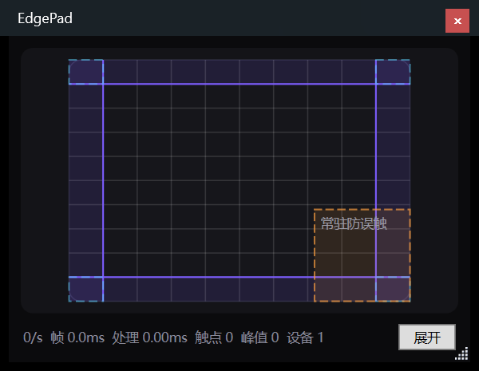

# EdgePad · 触控板边缘手势

给 Windows 精准触摸板（Precision Touchpad）补上系统没给的边缘手势：**边缘滑动、角落双击、五指拖动、双指画 L/X**，
全部从触控板本身读出来，不依赖厂商驱动，也不改系统设置。

针对 Apple Magic Trackpad 2（USB/PTP 模式）实测开发，任何上报 PTP 集合（Usage Page 0x0D / Usage 0x05）的触控板都能用。



## 解决什么问题

Magic Trackpad 在 Windows 上只能用系统那套三指/四指手势，边缘和角落是空的。
EdgePad 把触控板的四个边缘、四个角落做成独立的触发区，手指从边缘起手滑动就触发动作，
而且**动作期间光标不动**——不会顺带把指针带跑偏。

| 区域 | 手势 | 默认动作 |
|---|---|---|
| 左边缘 | 上滑 / 下滑 | 音量 + / 音量 − |
| 右边缘 | 上滑 / 下滑 | 向上滚动 / 向下滚动 |
| 顶边缘 | 左滑 / 右滑 | 后退 / 前进（Alt+← / Alt+→） |
| 底边缘 | 左滑 / 右滑 | Alt+← / Alt+→ |
| 边缘 | 双击 | 静音、窗口截图 |
| 四角 | 双击 / 三击 | Esc、窗口截图、全屏截图… |
| 全板 | 五指停稳后拖动 / 捏合 | 拖动窗口（松手吸附）/ 切换窗口 / 最大化 |
| 全板 | 双指画 L / 画 X / 画圈 | 锁屏 / 关闭当前窗口 / 未设置 |

每个动作都能改成任意快捷键、启动命令或内置动作（截图、媒体键、窗口操作、滚动、锁屏），
每个动作还有独立开关，可以单独停用。

**角落与边缘**：角落既是两条边缘的交界，也是「边缘点击」里单独的触发区——在角落起手的**滑动**仍走边缘手势，
**双击/三击**走角落动作。右下角默认在防误触区内。

| 边缘点击 | 全板手势 |
|---|---|
|  |  |

## 其他细节

- **防误触**：右下角常驻手掌区（可拖动范围）+ 打字期间暂停全部手势（听键盘原始输入判断）
- **屏蔽系统点击**：边缘双击时把系统“点按即点击”合成的那次点击吞掉，不会顺手点到东西
- **回执提示**：截图完成、上一首/下一首会在右下角弹一条提示（媒体键会带上正在播放的曲目）

| 悬浮小窗 | 提示条 |
|---|---|
|  |  |

- **托盘常驻**：最小化到托盘继续生效，可设开机自启
- **性能**：报文处理 P50 0.01ms（P99 0.03ms）｜帧间隔 8.0ms / 125Hz；界面线程有卡顿探针，日志里能查到是谁卡的

## 快速开始

### 直接下载

到 [Releases](https://github.com/lyfZhixing/edgepad/releases) 下载 `EdgePad.exe`（单文件、免安装、自带运行时），双击运行。
首次运行 Windows 可能提示“未知发布者”，选「更多信息 → 仍要运行」。

### 自己构建

需要 .NET 10 SDK：

```bash
cd edgepad
dotnet build -c Release
./bin/Release/net10.0-windows10.0.19041.0/EdgePad.exe
```

打包成单文件：

```bash
dotnet publish -c Release -r win-x64 --self-contained true \
  -p:PublishSingleFile=true -p:IncludeNativeLibrariesForSelfExtract=true -o publish
```

## 前提与限制

- 只支持**精准触摸板**（设备管理器里显示 “HID-compliant touch pad” 且是 PTP 集合）。
  普通鼠标、老式 Synaptics/Elan（PS/2）触摸板不行。
- 系统级三指/四指手势、双指滚动无法从用户态拦截：**双指画 L/X 时页面会同时滚动**，
  建议在「设置 → 蓝牙和其他设备 → 触摸板」里关掉双指滚动（右边缘滚动已经能顶替）。
- 五指捏合可能与系统四指手势冲突，建议把系统四指手势设为“无”。
- 光标冻结是系统级的（`ClipCursor` 钉在 1×1），只在该手势持续的那一下（通常 <1s）。
- 阈值、边缘带宽度、防误触范围都能在界面里拖/调。

## 目录

| 路径 | 说明 |
|---|---|
| `*.cs` / `*.xaml` | 程序本体（WPF，目标框架 `net10.0-windows10.0.19041.0`） |
| `Engine.cs` | 手势状态机：边缘锁定、方向判定、点击链、五指、双指轨迹 |
| `TouchpadSource.cs` | 枚举 PTP 集合、解码 HID 报文为触点 |
| `PadView.cs` | 点阵图渲染与边缘带拖动 |
| `docs/edge-pad.md` | 完整设计记录：决策、实测数据、排错过程 |
| `tools/*.ps1` | 开发用：截图、窗口定位、剪贴板、CPU / 日志观察 |

## 自检

```bash
EdgePad.exe --selftest       # 手势状态机 57 项
EdgePad.exe --patterntest    # 双指轨迹识别 11 项
EdgePad.exe --migratetest    # 配置迁移 18 项
EdgePad.exe --perftest       # 单帧处理耗时实测
EdgePad.exe --scrollbench    # 滚动 / 注入 / 日志耗时
```

## License

MIT
