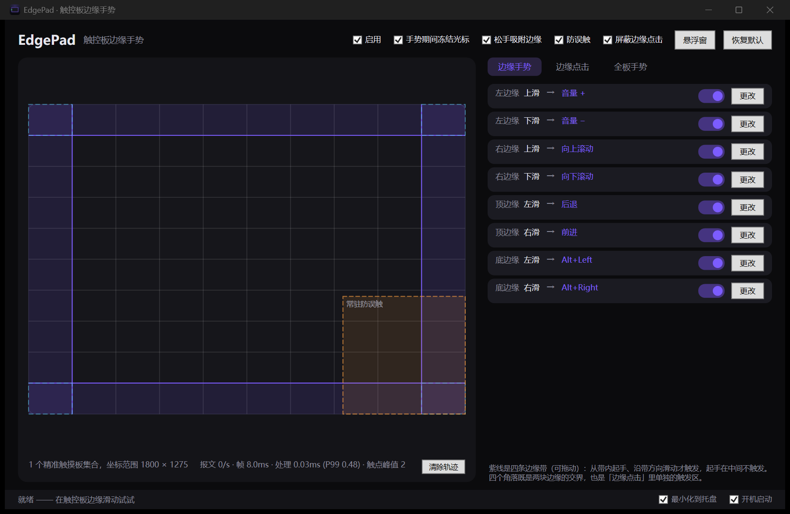
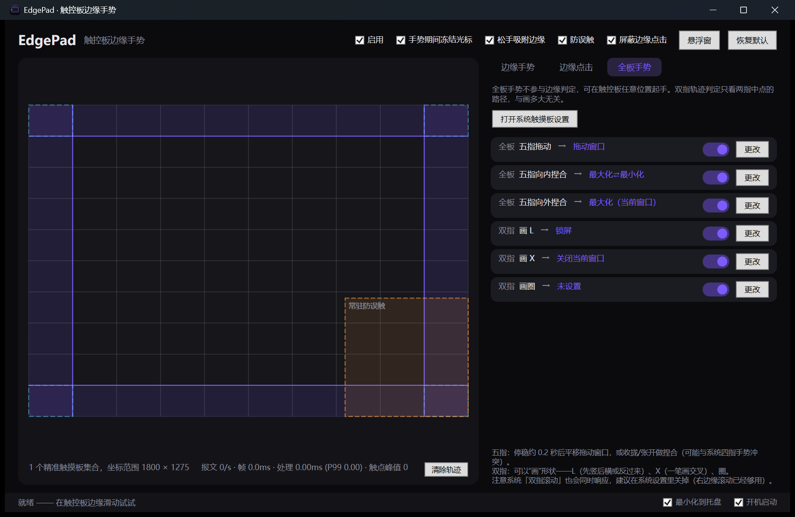
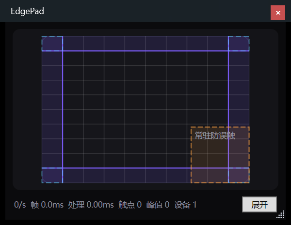
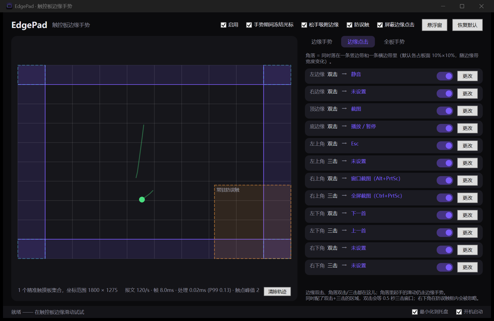

# EdgePad —— 触控板边缘手势控制台（Windows 图形程序）

> 物理触控板（Apple Magic Trackpad 2，USB）在 Windows 下是**精准触摸板**，但 Windows 不提供边缘手势。
> EdgePad 用用户态旁路读取原始 HID 报文，补上四个边缘的滑动手势，并做成独立图形程序。
> 关联：[edge-gesture.md](edge-gesture.md)（可行性验证与命令行原型）· [hid-gesture-design.md](hid-gesture-design.md)



---

## 1. 七条需求 → 实现对照

| # | 需求 | 实现 | 验证 |
|---|---|---|---|
| 1 | 独立图形化控制软件 | WPF（.NET 10），单窗口，可执行文件 `bin/Release/net10.0-windows10.0.19041.0/EdgePad.exe` | 已运行并截图 |
| 2 | 读取点阵图 + 图形化调整四边范围 | 左侧实时点阵：网格 + 触点 + 700ms 渐隐轨迹；四条紫色边界线可直接拖动，范围 2%–45% | 拖动即时生效并写回设置 |
| 3 | 左右边缘支持上下滑 | 左/右边缘只认**竖向**位移（横向占优时忽略） | 自检 C/D/E |
| 4 | 上下边缘支持左右滑 | 顶/底边缘只认**横向**位移 | 自检 F/G |
| 5 | 起手必须在对应边缘内 | 触点落下那一刻做命中测试并锁存；落点在中部则**整段手势作废**（划进边缘也不认） | 自检 B |
| 6 | 手势期间鼠标焦点不动 | 手势开始瞬间 `GetCursorPos` + `ClipCursor` 锁定为 1×1 矩形，抬手或取消立刻 `ClipCursor(NULL)` | 实测 FROZEN |
| 7 | 边缘动作支持自定义 | 每个方向可选 19 个预设、可**录制任意组合键**、可运行命令 | 动作对话框 |

---

## 2. 界面


右栏分三个选项卡：**边缘手势**（8 项滑动）、**边缘点击**（12 项：4 条边缘双击 + 4 个角落的双击/三击）、
**全板手势**（3 项五指），上次停留的选项卡会被记住（`LastTab`）。



- **左**：触控板点阵图。绿色圆点是当前触点，拖着淡出的是轨迹；四条紫色半透明带就是左右上下边缘，拖动带边线即可调整，右上/左下角实时显示百分比。
- **右上五个开关**：启用、手势期间冻结光标、松手吸附边缘、防误触、屏蔽边缘点击。
- **右下两个开关**：最小化到托盘、开机启动（见 2.4）。
- **右栏选项卡**：边缘手势 12 项 / 全板手势 3 项，每项都有**独立开关**（关掉保留配置但不生效）和“更改”按钮。
- **底部状态栏**：设备数量、坐标范围、报文速率、帧间隔、处理耗时、触点峰值。

设置保存在 `%APPDATA%\EdgePad\settings.json`。版本升级新增的绑定键会自动补默认值，
已有配置不会被覆盖。

---

### 2.2 悬浮小窗



主窗口右上角的「**悬浮窗**」按钮把界面切成一个小巧的置顶窗口，只保留：

- 触控板点阵图（含四条边缘带与轨迹）
- 一行性能指标：报文速率 / 当前触点 / 触点峰值 / 设备数

| 特性 | 实现 |
|---|---|
| 置顶 | `Topmost=True` |
| 不占任务栏 | `ShowInTaskbar=False` + `WindowStyle=ToolWindow` |
| 位置 | 启动时贴到工作区右上角（`SystemParameters.WorkArea`） |
| 展开 | 窗口右下角「展开」按钮，或关闭小窗，都会恢复主窗口 |
| 命令行直达 | `EdgePad.exe --mini` 直接以悬浮窗启动 |

主窗口隐藏后**原始报文照常到达**：Raw Input 绑定的是窗口句柄，与可见性无关（系统正是用不可见的消息窗做这件事的）。
渲染频率同时从 90ms 提到 **33ms**，小窗里的触点更跟手。

### 2.3 性能指标

状态栏与小窗都会显示三项实时指标：

| 指标 | 含义 | 实测 |
|---|---|---|
| `报文 /s` | 每秒收到的 HID 报文数 | 空闲 90–140，滑动约 **123** |
| `帧 x.xms` | 相邻报文间隔的**中位数**，即设备采样周期 | **8.0ms**（≈125Hz） |
| `处理 x.xxms (P99)` | 从 `WM_INPUT` 收到报文到**解析 + 手势判定 + 动作派发**全部做完的耗时 | 现在 **0.01ms**（P99 **0.03–0.04ms**）；2026-11-24 之前是 0.05–0.09ms（P99 最高 1.10ms） |

帧间隔与处理耗时都用 `Stopwatch.GetTimestamp()` 打点，各自保留最近 256 个样本算中位数/P99。

**注意**：`处理` 只覆盖我们自己的代码，**不包含动作本身的系统响应**（音量键到音量条弹出、`SetWindowPos` 到画面真正移动）。
所以它衡量的是“有没有在我们这一层拖慢”，而不是端到端手感。

`处理` 曾经只统计到“解析完报文”为止，把注入和日志排除在外——结果真正的瓶颈（一档滚动阻塞 1ms）看不见。
现在它统计整段；注入已挪到后台线程（见 3.3），所以这个数字才有意义。

**界面卡顿探针**（2026-11-24 加）：后台线程每 20ms 给界面线程投一条消息，量它多久被处理。
只有出现 ≥20ms 的等待才写日志，≥50ms 会连“当时界面在干什么”一起写：

```
20:13:28.215  界面卡顿 156ms，当时在：空闲（等消息）
20:12:45.025  界面卡顿：10 秒内最久等待 62ms，超 20ms 2 次，超 50ms 1 次（采样 329）
```

界面线程卡住不只是窗口不刷新：低级鼠标钩子的回调也排在它后面，全系统的鼠标会跟着一起卡（见 6.8）。

### 2.4 托盘与开机启动

底部状态栏右侧两个开关：

| 开关 | 默认 | 行为 |
|---|---|---|
| **最小化到托盘** | 开 | 最小化、或点窗口的关闭按钮 → 窗口消失，手势**照旧生效**，进程留在托盘。首次会弹一次气泡说明 |
| **开机启动** | 关 | 写 `HKCU\Software\Microsoft\Windows\CurrentVersion\Run`，值为 `"<exe 路径>" --tray`。不需要管理员权限，随时可关 |

托盘图标（右键菜单）：

```
打开主界面
悬浮窗            ✓（当前是否在悬浮窗）
─────────
启用边缘手势      ✓
─────────
退出 EdgePad
```

- **退出只能从托盘菜单走**（或关掉「最小化到托盘」后再点关闭按钮）。这样“关窗口 ≠ 停手势”是显式的，不会出现“窗口关了但边缘还在乱触发”。
- `--tray` 启动参数：静默启动，只有托盘图标、不弹窗（开机自启用的就是它）。
- Win11 默认把新图标放进托盘溢出区（`^`），想常驻可见就把它拖到任务栏上。
- 自启的注册表值每次启动按当前 exe 路径刷新（`Autostart.SyncIfEnabled()`），程序换目录/换版本不会失效。

验证（不依赖手感）：

```bash
EdgePad.exe --startuptest on     # 写注册表并回读，结果写 startuptest.txt
EdgePad.exe --startuptest off
```

```
写入(on) 返回=True
IsEnabled()=True
```

外部再核对一次（64 位视图，与程序一致）：

```bash
reg query "HKCU\Software\Microsoft\Windows\CurrentVersion\Run"
# EdgePad  REG_SZ  "C:\...\EdgePad.exe" --tray
```

`--tray` 静默启动的验证：进程存活，且该进程的**全部**窗口 `visible=False`（用 `EnumWindows` 逐个查，见 `traylaunch.ps1`）。

### 2.1 图标


设计沿用应用内的视觉语言：深色圆角底板 + 精准触摸板（1800:1275）+ 四条紫色边缘带 + 左侧绿色触点与运动残影。

要素只有三个（板、四条边、一个点），所以 16px 标题栏里仍然能认出是"带边缘的触控板"。
尺寸梯度已经验过：16 / 24 / 32 / 48 / 64 / 128 均可读。

重新生成（Pillow）：

```bash
python make-icon.py     # 输出 app.ico
```

`app.ico` 同时作为 `ApplicationIcon`（嵌进 exe）和 WPF `Window.Icon`（标题栏/任务栏），
内含 256/128/64/48/32/16 六个尺寸。

## 3. 动作类型

| 类型 | 说明 | 连续/离散 |
|---|---|---|
| **按键** | 任意组合键，可录制（`Ctrl+Shift+K`、`Win+Up`…） | 离散，一次手势一次 |
| **音量** | 系统音量键 | **连续**，每 `VolumeStep`（默认 25 单位）一档 |
| **滚动** | `MOUSEEVENTF_WHEEL`，向上/向下 | **连续**，每 `ScrollStep`（默认 40 单位）一档（120 倍速=3 行） |
| **命令** | `cmd /c …` | 离散 |
| **拖动窗口** | 五指拖动时移动光标下的窗口 | 连续（跟手） |
| **最大化⇄最小化** | 最大化则还原，否则最小化 | 离散 |
| **最大化（当前窗口）** | 直接最大化 | 离散 |
| 未设置 | 不动作 | — |

### 3.0 每个动作的开关

15 个绑定项各自有一个开关（`ActionSpec.Enabled`，默认开）：

- **关掉后保留配置**，只是不再触发；动作文字变暗，一眼能看出哪些被停用
- 改动作（“更改”按钮）**不会改变开关状态**
- 存进 `settings.json` 的 `Enabled` 字段，重启后保持

适合“某个边缘动作老误触，但先不想删掉”的场景。

### 3.2 屏蔽边缘点击

**问题**：边缘双击时，Windows 的“点按即点击”会把两次轻点合成一次**真实的鼠标双击**，
于是“自定义动作 + 一次点击”同时发生。

先排除了一个误会：手势期间用来钉住光标的 `ClipCursor` 在屏幕四边都正常
（`cliptest2.ps1` 实测四个边缘 `moved=0`），所以和光标冻结无关。
左/上边缘看起来“没问题”，是因为点击落在屏幕边缘的空白处，看不出后果。

**做法**：低级鼠标钩子 `WH_MOUSE_LL`，在极短窗口内吞掉左键事件。

| 环节 | 规则 |
|---|---|
| 何时武装 | 触点**起手在边缘带内**，且该边缘的「双击」动作**已启用**（未绑定/已停用则不武装） |
| 窗口长度 | `DoubleTapMs + 300` = 800ms，覆盖两次轻点 |
| 何时解除 | 触点开始**滑动**（不再是轻点）时立即解除 |
| 吞什么 | `WM_LBUTTONDOWN` / `WM_LBUTTONUP` / `WM_LBUTTONDBLCLK` |

验证方式（不依赖手感）：

```bash
EdgePad.exe --clicktest     # 武装 3s，自己合成两次点击，输出被吞数量
```

```
钩子已安装，武装 3s
两次合成点击后被吞数量 = 4      ← 2 次点击 × (按下+抬起)
结论：钩子生效
```

顶部「屏蔽边缘点击」可整体关闭。

> **代价**：这是一枚全局钩子，窗口期内（边缘轻点后约 0.8 秒）会吞掉**所有**左键事件，
> 包括这期间的物理点击。窗口期一过立即恢复透传。

### 3.1 双击（每个边缘各一个）

四条边缘都能识别**双击**。左 / 顶 / 底边缘默认是 **静音**；**右边缘默认留空（未设置）**——
**右边缘双击默认留空（未设置）**——右边缘上下滑已经是滚动了，再叠一个双击动作容易误触，需要时点「更改」自己指定。

判定参数：

| 参数 | 值 | 含义 |
|---|---|---|
| `TapMaxMs` | 220 ms | 单次按下到抬起超过这个时长就不算轻点（长按/拖动会被排除） |
| `DoubleTapMs` | 380 ms | 两次轻点的抬手间隔上限 |
| 位移容差 | 2% 板宽/板高 | 超过就算拖动，该段不参与双击判定 |
| 位置容差 | 6% | 两次轻点必须落在同一块区域 |
| 同边约束 | — | 两次都必须起手在**同一条**边缘带内 |

抬手判定：`ContactCount==0`，或**超过 80ms 没有新报文**（真实报文 7ms 一帧，这个阈值只会在真的抬手时触发）。
界面定时器每 90ms 调一次 `Engine.Tick()` 兜底，避免设备不再上报时状态卡住。

> **副作用**：双击边缘时 Windows 自己的“点按即点击”也会产生两次单击，等于一次双击。
> 用户态无法拦截，这是已知代价（除非写 HID 过滤驱动）。

### 3.2 静音是“切换”不是“静音”

`静音` 动作发的是 `VK_VOLUME_MUTE`，语义是 **toggle**：双击一次静音，再双击一次取消。
连按两次等于没变——这不是失效。

为了不再“看起来没反应”，动作执行后会读回真实状态：

- 状态栏显示 `已静音（音量 34%）` / `已取消静音（音量 34%）`
- 日志记录 `动作 L.tap = 静音 -> 已发送 静音=True 音量=0.34`

验证方式（不依赖手感）：`EdgePad.exe --audiotest` 会直接调用同一条代码路径并写出 `audiotest.txt`。

滚动和音量是同一套“连续量”机制：位移有多少就发多少档，往回滑会往回退，不是一次手势只触发一次。
一档 = `WHEEL_DELTA`(120) = 3 行；默认 40 单位一档，整块板高度可滚约 32 档（≈2 屏）。

### 3.3 滚动为什么“卡”

用户报的现象：右边缘上下滑滚动时“有些卡顿，不丝滑”。测量后原因是**一档滚动要阻塞报文线程约 1ms**，不是报文丢失，也不是帧率不够。

`EdgePad.exe --scrollbench`（结果写 `scrollbench.txt`）测出三个数：

| 环节 | 旧做法 | 实测 | 现在 |
|---|---|---|---|
| 发一档滚轮 | 在 `WM_INPUT` 线程里直接 `SendInput` | 平均 **1231µs**，中位 1012µs，P99 4720µs，**最大 13.6ms** | 交给注入线程，UI 线程只入队 **30µs** |
| 写一行日志 | 每档一行 `AppendAllText`（还带 `Directory.Exists` + `FileInfo`） | 平均 **307µs** | 入队 **5.3µs**（后台每 250ms 批量落盘） |
| 逐档写日志 | 每档都写一行 | 40 档/秒 = **12.3ms/s** 的 UI 线程时间 | 每档不写，手势结束写一行汇总 |

关键数字是那个 **13.6ms**：报文间隔只有 8ms，一次 `SendInput` 就能把三帧报文堵在队列里。
堵住之后报文会成串到达，手感就是“顿一下、窜一下”。日志再叠加 0.3ms/档，共同把 `处理` 从 0.03ms 拉到不可控。

三处改动：

| 改动 | 文件 |
|---|---|
| 注入队列：所有 `SendInput`（滚轮、按键、组合键）统一交给一个后台线程，UI 线程只入队 | `Injector.cs`（新） |
| 异步日志：只入队，定时器批量落盘 | `Log.cs`（新） |
| 逐档不再写日志；手势结束写一行 `抬手 右边缘 时长=320ms moved=True latched=False tap=False 触发=17次` | `Engine.cs` |

另外加了两道防线：单帧最多补 6 档（触点跳变时不一次性倾泻几十档），以及 `处理` 指标改成统计
“解析 + 手势 + 派发”的整段耗时——旧版只统计解析，把真正的瓶颈排除在外了。

**节奏本身不是问题**：合成 45 帧、每帧 8ms 的缓入缓出滑动，实测单帧最多 1 档、档间隔平均 16.5ms、最大 32ms，
也就是说滚动脉冲本来就跟得上 125Hz 报文；卡顿全部来自上面的阻塞。

> 顺带记一个坑：右边缘下半段（`y ≥ 0.62`）落在右下角常驻防误触区里，**在那里起手的滑动会被当作手掌忽略**。
> 这是防误触的既定行为（见 4.3），不是滚动的问题；如果觉得别扭，把虚线框往上/往左拖小一点即可。

### 3.5 角落触发区与三击

四个角落 = **一条竖边带 ∩ 一条横边带**（默认各 10%，随边缘带宽度一起变），点阵图上用紫色虚框标出来。
角落是**独立的触发区**：双击/三击落在角落里，走角落的动作，不会再触发那条边缘的双击。

| 规则 | 说明 |
|---|---|
| 区域判定 | 起手点同时落在某竖边带和某横边带内 → 角落（TL/TR/BL/BR）；否则按原来的边缘判定 |
| 同一角落 | 500ms 内、位置差 ≤6% 的连续轻点累加：2 次 = 双击，3 次 = 三击 |
| 三击与双击并存 | 该角落同时配了双击和三击时，**双击延迟到三击窗口（500ms）过期**才发，避免抢在第三击之前 |
| 滑动不受影响 | 角落里起手的**滑动**仍然走边缘手势（音量/滚动等），角落只接管轻点 |
| 点击屏蔽 | 该区域有动作时才武装 `WH_MOUSE_LL`，窗口 = 双击窗口 +（配了三击则再加 500ms） |
| 键名 | 边缘 `L.tap2`，角落 `TL.tap2` / `TL.tap3` …（老配置的 `L.tap` 由 Schema 4 迁移过来） |

「**边缘点击**」页共 12 项：4 条边缘的双击 + 4 个角 × (双击, 三击)。



默认绑定：

| 区域 | 双击 | 三击 |
|---|---|---|
| 左上角 | **Esc** | 未设置 |
| 右上角 | **窗口截图（Alt+PrtSc）** | **全屏截图（Ctrl+PrtSc）** |
| 左下角 | 未设置 | 未设置 |
| 右下角 | 未设置 | 未设置 |

两个提醒：

- **右下角在「常驻防误触」框里**（默认 x≥72%、y≥62%），那里的触点起手就被当作手掌忽略，
  所以右下角要生效得把橙色虚线框拖小。
- `Ctrl+PrtSc` 不是 Windows 原生的全屏截图快捷键（原生是 `PrtSc` 或 `Win+PrtSc`），
  某些程序里按了不会有反应。预设里另外给了「全屏截图（PrtSc）」，点「更改」换成它即可。

### 3.6 截图回执

按了截图快捷键之后，右下角弹一个小提示条告诉你**到底截没截到**，不用再去粘贴一次才知道。

| 环节 | 做法 |
|---|---|
| 哪些动作算截屏 | 键值里含 `PrintScreen` / `PrtSc`，或就是 `Win+Shift+S`（自定义组合键也认） |
| 怎么判定成功 | 发键前记下 `GetClipboardSequenceNumber()`，260ms 后查一次（最多 3 次，每次 +320ms）：序号变了、且 `Clipboard.ContainsImage()` 为真 |
| 成功 | 「截图已完成 · 1920×1080，已复制到剪贴板」 |
| 序号没变 | 「没检测到截图 · 快捷键发了，但剪贴板没变化——这个组合键可能没生效」 |
| 变了但不是图片 | 「剪贴板已更新 · 但不是图片」 |
| 框选截图 | `Win+Shift+S` 不等待：直接提示「截图工具已打开」，因为要等用户拖选区域 |
| 提示条本体 | 右下角、置顶、**不抢焦点也不挡点击**（`WS_EX_NOACTIVATE | WS_EX_TRANSPARENT | WS_EX_TOOLWINDOW`），1.4 秒后淡出 |


验证（不依赖手感）：

```bash
EdgePad.exe --shottest shot.win     # 真发一次 Alt+PrtSc，看剪贴板到底变没变
EdgePad.exe --toasttest             # 只弹提示条，用来核对样式
```

```
发之前 剪贴板序号=17525
动作 窗口截图（Alt+PrtSc） = Alt+PrintScreen  IsScreenshot=True
发之后 剪贴板序号=17529 变化=True
剪贴板图片=1287×1335
结论：截图确实进了剪贴板
```

用序号而不是“剪贴板里有没有图”来判断，是因为剪贴板里可能本来就有一张旧图——
那样每次都会误报“已完成”。

### 3.7 媒体键回执

上一首 / 下一首 / 播放暂停 按完也会弹提示，而且提示里带**播放器自己报的曲目**——
这样能确认按键真的生效了，而不是“按了但没反应”。

| 环节 | 做法 |
|---|---|
| 认哪些动作 | 键值为 `MediaNext` / `MediaPrev` / `MediaPlayPause` |
| 读什么 | Windows 媒体会话（SMTC，`Windows.Media.Control`）：当前会话的 标题 / 艺术家 / 播放状态 |
| 什么时候读 | 发键前记一份，之后 350ms、830ms、1310ms、1790ms 各读一次 |
| 曲目变了 | 「下一首 · 周杰伦 - 稻香 ▶」 |
| 一直没变 | 「下一首 · 已发送媒体键 · <当前曲目>」（有些播放器单曲循环，或压根不报 SMTC） |
| 读不到会话 | 「下一首 · 已发送媒体键（没读到播放器信息）」 |


两个实现上的坑：

- **SMTC 的激活在 UI（STA）线程上会同步卡住**（第一次直接挂死），所以整段读操作都放在
  线程池（MTA）里跑，并且每个 WinRT 调用都带 `Wait(2500)` 超时——回执可以失败，但不能把主程序卡住。
- 为了用 SMTC，目标框架从 `net10.0-windows` 换成了 **`net10.0-windows10.0.19041.0`**，
  输出目录随之变成 `bin/Release/net10.0-windows10.0.19041.0/`（需要 Windows 10 1809+）。

验证：

```bash
EdgePad.exe --mediatest          # 只读当前媒体会话
EdgePad.exe --mediatest next     # 发一次下一首，再连读三次（会真的切歌）
```

```
有会话=True
之前：南海姑娘 - 王菲 - 啊 南海姑娘  ▶
```

### 3.8 双指轨迹手势（L / X / 圈）

两根手指一起在板上“画”一个形状。判定只看**两指中点的路径**，与画多大、画在哪儿无关。

| 环节 | 做法 |
|---|---|
| 采样 | 恰好两个触点时，每帧记一次两指中点；同时盯两指间距 |
| 排除捏合 | 两指间距变化 > 60% 的，判定为捏合，不参与轨迹判定 |
| 归一化 | 等弧长重采样 48 点 → 平移到中心 → 等比缩放到 [-0.5,0.5]（不做旋转归一化：L 转 180° 还是 L，但转 45° 就不是） |
| L | 角点数 = 1、转角 65°~115°、两条腿都够直（弦长/弧长 > 0.8）且各占 25% 以上、不闭合 |
| X | 路径**自己交叉**过（\(\ge\)1 次）、至少 1 个角、转角 < 155°（排除来回折返）、总长 < 4 |
| 圈 | 首尾距离 / 周长 < 0.22（闭合）+ 圆度 \(4\pi A/P^2\) > 0.55 + 角点 \(\le\) 1 |
| 触发 | 两指抬起的瞬间判定并执行；一次手势最多触发一个动作 |

默认绑定：

| 手势 | 动作 |
|---|---|
| 双指画 **L** | **锁屏**（Win+L） |
| 双指画 **X** | **关闭当前窗口**（Alt+F4） |
| 双指画圈 | 未设置（见下） |

**锁屏为什么不发 Win+L**：SendInput 合成的 `Win+L` 会被系统忽略——日志里一路“已提交”，屏幕一点反应都没有。
现在「锁屏」是一个独立动作类型（`syslock`），直接调 `LockWorkStation()`；
老配置里手填的 `Win+L` 也会被转到系统调用（Schema 5 迁移）。

#### 和系统「双指滚动」的关系（重要）

我们拦不住系统动作。画形状时手指在动，**系统会同时按双指滚动去滚页面**。
不想被滚的话，把系统的双指滚动关掉：设置 → 蓝牙和其他设备 → 触摸板 → 滚动与缩放 → 双指滚动。
（右侧边缘滚动已经够用，关掉不影响日常。）

#### 验证（EdgePad.exe --patterntest）

合成 11 条轨迹，全部按预期分类：

```
[PASS] L 向下再向右        len=0.915 corners=1 maxTurn=87 cross=0 → L
[PASS] L 向右再向下        → L
[PASS] L 旋转 180°         → L
[PASS] X 一笔画（沙漏）    corners=2 maxTurn=138 cross=1 → X
[PASS] 圈                  close=0.00 round=1.00 corners=0 closed=True → Circle
[PASS] 直线（滚动）→ 不算   corners=0 → None
[PASS] Z 形 → 不算          corners=1 maxTurn=129（太尖）→ None
[PASS] 来回滚动 → 不算      maxTurn=180（折返）→ None
[PASS] 小抖动 → 不算        轨迹太短
[PASS] V 形（对勾）→ 不算    maxTurn=129 → None
[PASS] C 形 → 不算          close=0.27（不闭合）→ None
```

引擎侧另有 5 条用例（画 L / 画 X / 画圈触发，直线滑动与捏合不触发），在 `--selftest` 里。

## 4. 默认动作

| 区域 | 手势 | 动作 |
|---|---|---|
| 左边缘 | 上滑 / 下滑 / **双击** | 音量 + / 音量 − / **静音** |
| 右边缘 | 上滑 / 下滑 / **双击** | 上一首 / 下一首 / **未设置** |
| 顶边缘 | 左滑 / 右滑 / **双击** | 后退 `Alt+←` / 前进 `Alt+→` / **静音** |
| 底边缘 | 左滑 / 右滑 / **双击** | 上一个标签 / 下一个标签 / **静音** |

| 双指 | **画 L** / **画 X** / 画圈 | **锁屏** / **关闭当前窗口** / 未设置 |

| 左上角 | **双击** / 三击 | **Esc** / 未设置 |
| 右上角 | **双击** / **三击** | **窗口截图 Alt+PrtSc** / **全屏截图 Ctrl+PrtSc** |
| 左下角 | 双击 / 三击 | 未设置 / 未设置 |
| 右下角 | 双击 / 三击 | 未设置 / 未设置 |

| 全板 | **五指拖动** | 拖动窗口（类 macOS 三指拖拽） |

共 15 个绑定项：4 边缘 × 3 手势 + 3 个全板手势。

### 4.1 五指拖动

它**不是边缘手势**，不参与"起手必须在边缘带内"的规则，走独立分支：

| 环节 | 做法 |
|---|---|
| 触发 | 同一帧出现 **5 个触点**，且连续保持 150ms（防放置竞态，见 4.1.1） |
| 锚点 | 5 个触点的**质心**（不是某一根手指） |
| 目标窗口 | 起手瞬间 `GetCursorPos` + `WindowFromPoint`，再 `GetAncestor(GA_ROOT)` |
| 位移 | `(质心变化 / 板尺寸) × 屏幕尺寸 × DragGain`，直接调用 `SetWindowPos` |
| 结束 | 触点少于 5 个，或超时无报文 |
| 光标 | 拖动期间照常冻结（`ClipCursor`），不会满屏乱飘 |

排除项：桌面（`Progman`/`WorkerW`）、任务栏（`Shell_TrayWnd`）、开始菜单等不可拖动窗口；
最大化窗口会先 `SW_RESTORE` 再拖。

**为什么用 `SetWindowPos` 而不是合成鼠标事件**：合成 `WM_NCLBUTTONDOWN/HTCAPTION` 会进入
系统的模态移动循环，无法与外部的冻结/恢复协调；直接改窗口位置不抢输入，代价是**没有 Aero Snap 吸附**。

拖动增益 `DragGain` 默认 1.0：手指横跨整块板 = 窗口横跨整个屏幕。

### 4.1.1 与系统三指手势冲突（重要）

**现象**：五指拖动生效的同时，Windows 会执行三指“切换窗口”（Alt+Tab）。

**原因（放置竞态）**：Windows 的触摸板手势引擎在**最初 3 根手指落下并开始移动**时就锁定了“三指滑动”手势；
第 4、5 根手指随后落下，**不会撤销**已经确立的手势。我们的 Raw Input 与它读的是同一份报文，
区别只在于我们要求 5 个触点同时存在。

**为什么用户态拦不住**：触摸板手势由系统输入栈在 HID 之上解释，`RIDEV_INPUTSINK` 只拿到报文副本，
没有任何“吞掉/屏蔽”的能力。要真正屏蔽必须写 HID 上层过滤驱动（需要签名），不在用户态可达范围内。

**已做的缓解**：五指必须**先落稳 150ms** 才开始跟手（`DragArmMs`）。落指那段时间里没有位移，
系统就拿不到“三指滑动”所需的移动量，所以“五指同时落下 → 停一下 → 再拖”不会误触发。

**若仍偶发**：把系统的三指手势关掉（设置 → 蓝牙和其他设备 → 触摸板 → 三指手势 → 全部设为“无”）。
这些设置不在 `HKCU\...\PrecisionTouchPad` 键里，程序无法代为修改。

### 4.1.2 五指捏合

五指同时承担两种手势，靠**质心位移**与**触点间距**区分：

| 手势 | 特征 | 判定 |
|---|---|---|
| 拖动 | 质心平移，间距基本不变 | 间距比在 0.84–1.16 之间，且落稳 150ms |
| 向内捏合 | 间距收缩，质心基本不动 | 间距比 ≤ **0.84** 且质心漂移 < 6% |
| 向外捏合 | 间距张开，质心基本不动 | 间距比 ≥ **1.16** 且质心漂移 < 6% |

起手瞬间记录基线（质心、平均半径），之后逐帧比较。五指如果完全重合（间距 < 1% 板宽）则不参与捏合判定，只当拖动 —— 避免退化数据产生误判。

| 手势 | 默认动作 | 语义 |
|---|---|---|
| 向内捏合 | 最大化⇄最小化 | 当前窗口最大化时 → 还原；否则 → 最小化 |
| 向外捏合 | 最大化（当前窗口） | 直接 `ShowWindow(SW_MAXIMIZE)` |

**与系统四指手势的冲突**：捏合时手指向中心收拢，Windows 从 5 指里看到的 4 指子集
运动方向很像一次**竖向滑动**，于是可能触发系统的四指上/下滑。
已做的缓解：捏合阈值收紧到 ±12%（收敛距离更短）、五指序列对 80ms 内的丢指容忍。
**彻底避免只能关掉系统的四指手势**（界面上的「打开系统触摸板设置」按钮可直达）。

目标窗口与拖动一致：**光标下的窗口**（`WindowFromPoint` + `GetAncestor(GA_ROOT)`），并排除桌面/任务栏。两个动作都直接调用 Win32，不依赖窗口是否处于前台焦点。

### 4.3 防误触：两套机制

需求本身分两层，所以实现也是两套，互不干扰：

| 机制 | 生效时机 | 范围 |
|---|---|---|
| **右下角常驻防误触** | 一直生效（开关打开时） | 右下角矩形（默认 `x ≥ 72%`、`y ≥ 62%`，橙色虚线框） |
| **打字期防误触** | 键盘有输入后 400ms 内 | 整块触控板 |

整块触控板在非打字时**完全可用**，可触控区域没有被缩小。

#### 为什么不能用业界的“面积法”

Synaptics / Elan / Apple 的看家本领是**电容成像 + 触点面积**：手掌接触面积远大于指尖，
固件直接把它标掉，或通过 PTP 的 `Confidence` 位告诉系统“这条不可信”。
Windows 自己的 AAP（意外激活防护）同样依赖设备上报的**触点宽高**（`0x0D/0x48`、`0x0D/0x49`）。

**这块板没有宽度/高度。** 描述符里只有：

```
5 × (Contact Identifier, X, Y) + Contact Count + Scan Time = 17 个 value cap
```

所以面积法、置信位、系统 AAP 在这里全部失效 —— 只剩**区域 + 时序**两种先验可用。

#### 右下角常驻

触点**起手**（第一次出现）落在框内 ⇒ 立即判为手掌，之后即使移动也保持忽略，直到该触点消失。
框的左上角两条边可以直接拖动调整。

#### 打字期（整板）

程序额外注册 `0x01/0x06`（键盘）到 Raw Input，**只判断“有没有按键”，不读键值**：

- 任意按键后 **400ms** 内 = 正在打字
- 打字期间**暂停全部手势**（等价于业界“打字时禁用触摸板”）

`TypingPauseAll=false` 可只暂停活动区内的判定，`TypingQuietMs` 调整静默时长。

#### 参数

`PalmGuard`、`PalmX0`、`PalmY0`、`TypingGuard`、`TypingQuietMs`、`TypingPauseAll`。
### 4.2 松手吸附（自实现的 Aero Snap）

松手瞬间按窗口**当前矩形**与所在显示器**工作区**（`rcWork`，已排除任务栏）的相对位置判定：

| 窗口贴到的边 | 结果 |
|---|---|
| 左 | 左半屏 |
| 右 | 右半屏 |
| 上 | 最大化 |
| 左上 / 右上 / 左下 / 右下 | 对应 1/4 屏 |
| 仅下边 | 不吸附（与 Windows 行为一致） |

判定阈值 **24 DIP**（按窗口 DPI 缩放，最小 12px）。显示器取 `MonitorFromWindow`，所以多屏下按各自的工作区计算。

界面上的「松手吸附边缘」可以关掉。

> 未做排除：EdgePad 自己的窗口同样可以拖动和吸附（按需求保留）。

可选预设共 21 个，含 **向上滚动 / 向下滚动**、音量、媒体、标签切换、前进后退、窗口贴边、截图等。

避开系统手势：三指上/下滑、三指左右、四指左右、三指轻点、两指滚动缩放都已由 Windows 占用，这里一律不重复。

---

## 5. 代码结构

| 文件 | 职责 |
|---|---|
| `Native.cs` | SetupAPI / HID / Raw Input / SendInput / ClipCursor 的全部 P/Invoke |
| `TouchpadSource.cs` | 枚举完整的精准触摸板集合，读能力表拿坐标范围，解码报文为触点列表 |
| `PadView.cs` | 点阵图渲染（`OnRender`）+ 边界拖动 |
| `Engine.cs` | 手势状态机：起手锁定、方向判定、阈值/锁存、光标冻结、按键注入 |
| `Model.cs` | 设置模型、预设动作表、JSON 持久化 |
| `ActionDialog.cs` | 动作编辑对话框（预设 / 录制组合键 / 命令） |
| `WindowDrag.cs` | `IWindowTarget` 抽象 + 系统实现（找窗口/移动窗口），便于自检注入假目标 |
| `Audio.cs` | CoreAudio：读默认端点的静音与音量 |
| `SelfTest.cs` | `--selftest`：用合成触点验证状态机，结果写 `selftest.txt` |
| `Injector.cs` | 注入队列：所有 `SendInput` 都在后台线程发，UI 线程只入队 |
| `Log.cs` | 异步日志：入队 + 250ms 批量落盘（原来每行同步写盘 307µs） |
| `Autostart.cs` | 开机自启：只写 HKCU 的 Run 键，带 `--tray` |
| `Tray.cs` | 托盘图标与右键菜单（WinForms `NotifyIcon`，图标复用 `app.ico`） |
| `ScrollBench.cs` | `--scrollbench`：滚动节奏 / 注入耗时 / 日志耗时 / 托盘与自启的测量 |
| `Patterns.cs` | 双指轨迹识别：重采样 + 角点/自交/闭合度/圆度 → L / X / 圈 |
| `ClickSuppressor.cs` | 屏蔽系统“点按即点击”的合成左键：低级鼠标钩子装在**独立线程**上（不能挂界面线程） |
| `UiPing.cs` | 界面线程卡顿探针：20ms 一次投递，量界面响应延迟，卡了才写日志 |
| `PerfTest.cs` | `--perftest`：按 125Hz 喂合成触点，量单帧处理耗时与轨迹判定耗时 |
| `MediaWatch.cs` | 读 Windows 媒体会话（SMTC）：媒体键回执的曲目信息 |
| `Toast.cs` | 右下角提示条：置顶、不抢焦点、鼠标穿透、1.4s 淡出 |

---

## 6. 验证记录

### 6.1 状态机自检（`EdgePad.exe --selftest`）

```
[PASS] 中部起手下滑不触发
[PASS] 中部起手划进边缘不触发        ← 需求 5 的核心
[PASS] 左边缘上滑=音量+ 4 档
[PASS] 左边缘下滑=音量- 3 档
[PASS] 右边缘下滑只触发一次
[PASS] 顶边缘左滑
[PASS] 底边缘右滑
[PASS] 左边缘横向滑动不触发
[PASS] 双指不触发
[PASS] 抬手后可再次触发
[PASS] 右边缘上滑=向上滚动 3 档
[PASS] 右边缘下滑=向下滚动 5 档
[PASS] 左边缘双击触发一次
[PASS] 边缘单击不触发
[PASS] 双击间隔过长不触发
[PASS] 长按不算轻点
[PASS] 拖动不参与双击判定
[PASS] 顶边缘双击触发一次
[PASS] 1024x600 触控板左边缘上滑=音量+ 4 档
[PASS] 1024x600 触控板底边缘右滑
[PASS] 双指后单指边缘仍可用
[PASS] 双指后无抬手报文也能恢复
[PASS] 五指拖动移动窗口
[PASS] 五指松开后停止拖动
[PASS] 未绑定拖动窗口时不抓窗口
[PASS] 松手吸附到左半屏
[PASS] 关闭吸附开关后不吸附
[PASS] 五指向内捏合
[PASS] 五指向外捏合
[PASS] 五指平移不误判为捏合
[PASS] 五指短暂丢指仍能捏合
[PASS] 停用的动作不触发
[PASS] 右下角常驻防误触
[PASS] 右下角内移动也被忽略
[PASS] 右下角之外任意位置可起手
[PASS] 打字期间手势全部暂停
[PASS] 停止打字后恢复
[PASS] 关闭防误触后右下角可起手
[PASS] 位移不足阈值不触发
[PASS] 伪触点被丢弃
[PASS] 连续手势抖动会自动停手
[PASS] 连续手势超过 3 秒停手
[PASS] 左上角双击 = Esc
[PASS] 右上角双击等三击窗口后触发
[PASS] 右上角三击 = 全屏截图
[PASS] 角落与边缘双击互不串台
[PASS] 左上角起手的上滑仍是左边缘
[PASS] 左下角/右下角默认不绑定
[PASS] 截屏动作识别
[PASS] 框选截图单独识别
[PASS] 媒体键识别
[PASS] 双指画 L 触发
[PASS] 双指画 X 触发
[PASS] 双指画圈触发
[PASS] 双指直线滑动不触发
[PASS] 双指捏合不算轨迹
结果：通过 56 项，失败 0 项
```

### 6.2 静音链路（`EdgePad.exe --audiotest`）

```
端点: 耳机 (2- HUAWEI FreeClip)
初始 静音=False 音量=0.34
发静音键 返回=True  之后 静音=True
再发一次            之后 静音=False
已还原为 False
```

证明：程序内的按键注入能真正改变系统默认播放端点的静音状态，且静音是切换语义。

### 6.3 光标冻结（`cliptest.ps1`）

锁定为 1×1 后强制 `SetCursorPos` 移开 300×120 px，实测光标位移 **dx=1 dy=1**（1×1 矩形允许的舍入）。释放后再移动，光标恢复正常移动，说明限制确实解除。

### 6.4 数据通路

- 报文速率：空闲 90–140 /s，滑动时约 143 /s（≈7ms 一帧）
- 坐标范围：`1800 × 1275`
- 手指压在最外侧边缘时原始坐标仍是满幅（`x=1799` / `x=1800`），所以边缘起手可识别

### 6.5 滚动流畅度（`EdgePad.exe --scrollbench`）

```
== 1. 日志写入成本（每档滚动要写一行）==
旧（同步写盘）: 300 次共 111.4ms，单次 371.4µs
新（入队异步）: 300 次共 1.9ms，单次 6.2µs，快 60 倍

== 1b. SendInput 发布一档滚动的耗时（300 次，含分配 INPUT 数组）==
旧（在报文线程同步 SendInput）: 平均 1013µs，中位 846µs，P99 2845µs，最大 4292µs
新（入队，后台线程发）: 平均 27.2µs，中位 16.1µs，P99 216.8µs，最大 805.3µs

== 2. 右边缘滑动滚动的档位发布节奏（45 帧 / 8ms 一帧 / 缓入缓出）==
竖向 起点 y=780，位移 700 单位 / 每档 40 单位 → 共 17 档
单帧最多 1 档（≥3 档的帧 0 个）；档间隔 平均 16.5ms，最大 32.0ms
竖向 起点 y=1150，位移 700 单位 / 每档 40 单位 → 共 0 档
   ← 起点落在右下角常驻防误触区内

== 3. 托盘图标与开机启动 ==
托盘图标: 48×48（16~256 里取到的是 48）
开启: 返回=True 注册表实际值="...EdgePad.exe" --tray 读回=True
关闭: 返回=True 读回=False
```

### 6.6 托盘与静默启动

- 最小化到托盘：外部发 `WM_SYSCOMMAND/SC_MINIMIZE` 后 `IsWindowVisible=False`、进程存活（窗口隐了，手势不停）
- `--tray` 静默启动：进程存活，`EnumWindows` 列出该进程的 14 个窗口**全部** `visible=False`
- 开机启动：写 → 读回 `True` → 外部 `reg query` 确认注册表值存在 → 关 → 值被删除（已还原为用户原本的“关闭”）

### 6.7 配置迁移（EdgePad.exe --migratetest）

关键名改过几轮：边缘双击从 X.tap 改成 X.tap2（v4），画图模式删掉（v3），右边缘双击从静音改成未设置（v1）。
迁移用 Schema 版本号做，只跑一次，只改“用户没动过”的那一项：

```
[PASS] 老 L.tap 改名成 L.tap2 且内容不变
[PASS] 老键 L.tap 已被移除
[PASS] Schema → 4
[PASS] 老 R.tap 清空后改名成 R.tap2
[PASS] 用户设的 T.tap 搬到 T.tap2
[PASS] 画图模式绑定被清理
[PASS] 清理后开关是关的
[PASS] v4 配置不再改动
[PASS] 缺键补默认 L.tap2=静音
[PASS] 默认 左上角双击=Esc
[PASS] 默认 右上角双击=窗口截图
[PASS] 默认 右上角三击=全屏截图
[PASS] 默认 左下角双击=未设置
[PASS] 默认 右下角三击=未设置
[PASS] 默认 右边缘双击=未设置
[PASS] 滑动 8 项 / 点击 12 项 / 全板 3 项
[PASS] 四个角落共 8 个动作
结果：通过 17 项，失败 0 项
```

### 6.8 “加了双指轨迹后正常操作卡顿”（2026-11-24 排查）

用户反馈：双指轨迹手势上线后，**日常操作**（移动光标、点击、滚动）明显卡顿。

**先量双指本身**（`EdgePad.exe --perftest`，按 125Hz 喂合成触点，预热后统计）：

```
单指 中部移动（基准）      P50 0.2µs · P99 0.3µs · max 1.8µs
双指 直线滚动（最常见）    P50 0.3µs · P99 0.6µs · max 6.4µs
双指 反复滚动 60 次        P50 0.4µs · P99 2.4µs · max 12.9µs ｜抬头帧 P50 42µs
双指 画 L（含抬手判定）    P50 0.2µs · P99 0.5µs · max 12.1µs ｜抬头帧 P50 33µs
识别器 Classify(400 点 L)  平均 60µs
```

单帧预算 8000µs，双指轨迹每帧只占 **0.2µs**（记两指中点的两个 double），抬手判定 33µs。
**结论：双指轨迹本身不可能是卡顿来源。** 于是转去查“同样的操作，为什么我们的进程会让整机变卡”，找到三处真实延迟：

| # | 问题 | 证据 | 处理 |
|---|---|---|---|
| 1 | 低级鼠标钩子（`WH_MOUSE_LL`）装在 **WPF 界面线程**上：钩子回调由“安装它的线程”执行，于是全系统每一次鼠标事件（含移动）都要排到界面线程 | 界面卡顿探针实测界面线程会出现 **62ms / 156ms** 的等待，那段时间全系统鼠标都在等我们 | 钩子挪到独立线程（`EdgePad.MouseHook`，只等消息），装好 <1ms，界面线程不再参与 |
| 2 | 每帧报文都在堆上新建一堆临时对象：`AllocHGlobal`+`FreeHGlobal`、`new byte[]`、`new List<Contact>`、每触点 `new Contact`、每逻辑集合 `new ushort[16]`、每帧查一次设备路径（走注册表）、防误触每帧 `new HashSet`+`new List` | `处理` 从 0.05–0.09ms（P99 最高 1.10ms）降到 **0.01ms（P99 0.03–0.04ms）** | 全部改成复用：原生缓冲、触点池、`ushort[16]`、路径缓存（按设备句柄）、防误触集合 |
| 3 | 没有任何报文时也按 30fps 整窗重绘点阵图 | 没有报文时的重绘从 **30 次/秒降到 0 次**；总 CPU 占用在 0.4–4% 之间随触控板操作波动，单独归因不出来（A/B 测过 33ms vs 100ms 定时器，差异被人手操作淹没） | 只有新报文、或轨迹还在淡出（700ms 内）才 `InvalidateVisual»；定时器有报文时 33ms、空闲 100ms |

另外修掉一处**输入线程阻塞**：起钩子线程时原来是“启动并等它就绪”，实测第一次 `SetWindowsHookEx` 前后能卡住调用线程 1 秒以上，
而调用方正是收到触控板报文的 `WM_INPUT` 处理路径 —— 表现就是启动后第一次边缘点击整整卡 1 秒（自检里就是“左边缘上滑 4 档”变成 0 次）。
现在起线程 / 装钩子完全不等，钩子没装好时只是这一次不吞点击。

**顺带**：双指“未识别”日志限流到 2 秒一条（原来每次双指滚动都写一行）。

## 7. 已知限制

| 限制 | 说明 |
|---|---|
| 必须保持程序运行 | 关窗口 / 最小化会收进托盘（手势继续），要真停得从托盘菜单退出 |
| 冻结光标是系统级的 | 手势期间（通常 <1s）整个桌面的光标都被钉住，这正是需求 6 要的效果 |
| 阈值固定 90 单位 | 约板高 7%；如需调节可加到界面 |
| 音量靠系统音量键，每档 2% | 后续可换 CoreAudio 做连续调节 |
| 注入失败只在状态栏提示 | `SendInput` 返回 0 时会显示“动作未生效：…” |
| 事件日志 | `%APPDATA%\EdgePad\edgepad.log`，记录按下/抬手/双击/动作结果 |
| 拖动边界线未保存到磁盘 | 关闭窗口时统一保存 |

---

## 8. 分发给别人能用吗

**能用，前提是对方的触控板也是 Windows 精准触摸板（Precision Touchpad）。**

EdgePad 只认 HID 顶级集合 `0x0D/0x05`，不看厂商 ID，所以对任何合规的精准触摸板都生效
（苹果、戴尔、联想、Surface、各种 USB 触控板都算）。

### 8.1 不支持的情况

| 设备 | 结果 | 原因 |
|---|---|---|
| 普通鼠标 | 无 | 不是 `0x0D/0x05` 集合 |
| 老式 Synaptics / Elan（PS/2 驱动） | 无 | 走厂商私有协议，不是 PTP |
| 只把触控板当鼠标上报的设备 | 无 | 同上 |
| 触摸屏 / 数位板 | 无（当前过滤掉） | 同为 0x0D 但不是 Touch Pad 用法 |

判断方法：设备管理器里有没有 **“HID-compliant touch pad”**；Win11 设置里有没有“触摸板”手势页。

### 8.2 已做的移植性修正（2026-11-23）

| 问题 | 原来 | 现在 |
|---|---|---|
| 坐标量程 | 全局取最大，笔记本内屏(1024×600)+外接(1800×1275) 会算错 | **每台设备用自己的量程**，逐报文携带 |
| 检测门槛 | 假设 5 指 / 30 字节 / 17 value，2 指设备被漏掉 | 只要 `0x0D/0x05` 且报告 ≥8 字节、≥3 个 value |
| 手指数 | 硬编码 1..5 | 从 Contact Identifier 数量推导 |

自检里补了两条 1024×600 的跨量程用例（共 21 项）。

### 8.3 打包

```bash
# 单文件自包含（对方无需装 .NET，约 134MB）
dotnet publish -c Release -r win-x64 --self-contained true \
  -p:PublishSingleFile=true -p:IncludeNativeLibrariesForSelfExtract=true -o publish

# 或者框架依赖（约 200KB，但要求 .NET 10 桌面运行时）
dotnet publish -c Release -r win-x64 --self-contained false -o publish-fx
```

### 8.4 分发时对方会遇到

- **未签名** → SmartScreen 提示“Windows 已保护你的电脑”，需点“更多信息 → 仍要运行”
- 首次运行会在 `%APPDATA%\EdgePad` 建配置和日志
- 开机自启（HKCU Run）与托盘都在界面底部开关里，默认不自启
- 界面只有中文

## 9. 排错

### 9.1 用一会儿突然不生效（2026-11-23 修复）

**现象**：刚启动时边缘手势正常，过一段时间全部失效；但界面上**指针轨迹仍然正常刷新**，说明报文一直在进来。

**根因（已定位）**：双指滚动会永久锁死引擎。

```csharp
// 旧代码
if (n >= 2 || cc >= 2) {
    Reset();          // 这里把 _down 置成 false
    _multi = true;    // 但 _multi 之后没有任何地方清除
    return;
}
if (n == 0) { if (_down) EndGesture(now); return; }   // _down 已是 false → 不会走 Reset
```

抬手报文到达时 `_down` 已经是 `false`，`EndGesture()` 不会被调用，`Reset()` 也就不会执行，
于是 `_multi` 永远是 `true`。之后每一帧都在 `if (_multi) return;` 处返回 ——
**轨迹照常画（那是 PadView 画的），引擎却完全停摆，日志也一行不写**。

**修复**：

| 位置 | 改法 |
|---|---|
| 抬手报文 | `n==0` 时无论 `_down` 与否都清 `_multi` |
| 空闲兜底 | `Tick()` 里超过 80ms 无报文也清 `_multi` |
| 可观测性 | 进入/退出多指状态各写一条日志 |

新增回归用例（正是这个 bug 漏掉的场景）：

```
[PASS] 双指后单指边缘仍可用
[PASS] 双指后无抬手报文也能恢复
```

### 9.2 设备重新枚举（独立的健壮性修复）

精准触摸板不保证路径稳定 —— USB 选择性挂起唤醒、重新插拔、切换另一台触控板，
都会让 Windows 重新枚举出**新的实例路径**（例如 `8&2F072CE8` → `8&56C9346`）。
早期版本只在启动时枚举一次，新路径不在字典里就会静默丢报文。

| 措施 | 说明 |
|---|---|
| 未知路径现场补扫描 | 收到没登记过的设备报文时重新枚举并补登记（限流 300ms） |
| 空闲定期重扫 | 超过 2s 没有报文时，每 3s 重扫一次设备表 |
| 无条件注册 Raw Input | 即使启动时一台设备都没有也先注册，等设备出现 |

新增日志行：

```
10:50:55.653  新增触摸板 vid_05ac&pid_0265&mi_01&col04#8&56c9346&0&0003 量程 1800×1275 触点数=5
```

### 9.2 完全没反应

看状态栏：

- `未找到精准触摸板` → 设备不是 PTP（见第 8 节）
- 有设备但没动作 → 看 `%APPDATA%\EdgePad\edgepad.log` 有没有 `按下` 行
  - 有 `按下` 但 `带内=False` → 起手没落在边缘带内，把带调宽
  - 完全没有 `按下` → 报文没进来（设备路径问题，见 9.1）

### 9.3 “没碰左边缘却调了音量”（2026-11-24 修复）

现象：用户报“在非左边缘触发了音量调节”。查日志（%APPDATA%\EdgePad\edgepad.log）找到两条线索。

**线索 1：伪触点帧。** 日志里有这种启动位置：

```
16:03:18.943  按下 (1800,0) 区域=右边缘 带内=True
16:03:21.982  按下 (0,0) 区域=左边缘 带内=True
16:03:22.160  按下 (0,0) 区域=左边缘 带内=True
16:03:22.901  按下 (0,0) 区域=左边缘 带内=True
16:03:23.088  按下 (0,0) 区域=左边缘 带内=True
16:03:22.256  动作 L.tap = 静音 静音=True 音量=0.30
```

(0,0) 和 (1800,0) 正好是板的两个角。真手指不可能同时贴着两条边——
这是坐标位全 0 / 全 1 的伪帧解出来的极值。而 (0,0) 落在左边缘带里，于是被当成左边缘双击 → 静音。

修法：`TouchpadSource.IsPhantom(x, y, maxX, maxY)` —— 同时满足“贴着左右某条边”和“贴着上下某条边”的触点直接丢弃，
丢弃次数写进日志（最多记 20 条）。正常触摸如 (900,0)（顶边中段）、(0,600)（左边缘中段）不受影响。

**线索 2：一个触点在左边缘带里停了 9 秒。**

```
16:38:36.115  按下 (171,982) 区域=左边缘 带内=True
16:38:45.206  抬手 左边缘 时长=9094ms moved=True latched=False tap=False 触发=103次
```

9 秒里没有任何其它触点、也没有多指事件 —— 说明用户的手没在操作触控板，是**手掌/手侧压在板子左侧**在漂移。
音量是连续动作，每 25 单位（板高 2%）一档，台阶边界上 ±几单位的抖动就足以“加一档、减一档”来回响。

修法（都在 `Engine.HandleAxis` 的连续动作分支）：

| 措施 | 说明 |
|---|---|
| 反向滞回 | 往回走要跨过**半档**才认，台阶边界上的抖动不会前后各响一次 |
| 抖动检测 | 反向间隔过密（`_reversals * 150ms` 内又反向）且超过 6 次 → 判定抖动，整个手势停止响应 |
| 时长上限 | **音量**连续手势超过 **3 秒**就判定为手掌压着漂移，停止响应（滚动不受限，避免影响长时间滚动） |

日志现在把坐标和反向次数一起写出来，下次可直接判断是不是手掌：

```
抬手 左边缘 时长=9094ms moved=True latched=False tap=False 触发=103次 起=(171,982) 终=(158,1010) 反向=57次
```

顺带提醒：左边缘带是**板宽的 10%（180 单位）**，(171,982) 这个点确实落在带内——手指自己觉得“没贴边”很正常，
板子上并没有物理刻度。嫌边缘带太宽，在点阵图上把紫色竖线往右拖即可。

## 10. 运行

```bash
cd edgepad
dotnet build -c Release
./bin/Release/net10.0-windows10.0.19041.0/EdgePad.exe

# 只跑状态机自检
./bin/Release/net10.0-windows10.0.19041.0/EdgePad.exe --selftest

# 滚动 / 注入 / 日志 / 托盘 / 开机启动 的测量
./bin/Release/net10.0-windows10.0.19041.0/EdgePad.exe --scrollbench
./bin/Release/net10.0-windows10.0.19041.0/EdgePad.exe --clicktest
./bin/Release/net10.0-windows10.0.19041.0/EdgePad.exe --startuptest on     # 或 off
./bin/Release/net10.0-windows10.0.19041.0/EdgePad.exe --migratetest
./bin/Release/net10.0-windows10.0.19041.0/EdgePad.exe --mediatest        # 读当前媒体会话
./bin/Release/net10.0-windows10.0.19041.0/EdgePad.exe --mediatest next  # 真切一首再读
./bin/Release/net10.0-windows10.0.19041.0/EdgePad.exe --patterntest     # 双指轨迹识别自检
./bin/Release/net10.0-windows10.0.19041.0/EdgePad.exe --perftest        # 单帧处理耗时 / 轨迹判定耗时实测

# 常驻指标：CPU 与日志
powershell -File tools/cpuwatch.ps1 -sec 10
powershell -File tools/logtail.ps1 -n 40

# 静默启动：只有托盘图标、不弹窗（开机自启用的就是这个）
./bin/Release/net10.0-windows10.0.19041.0/EdgePad.exe --tray

```
